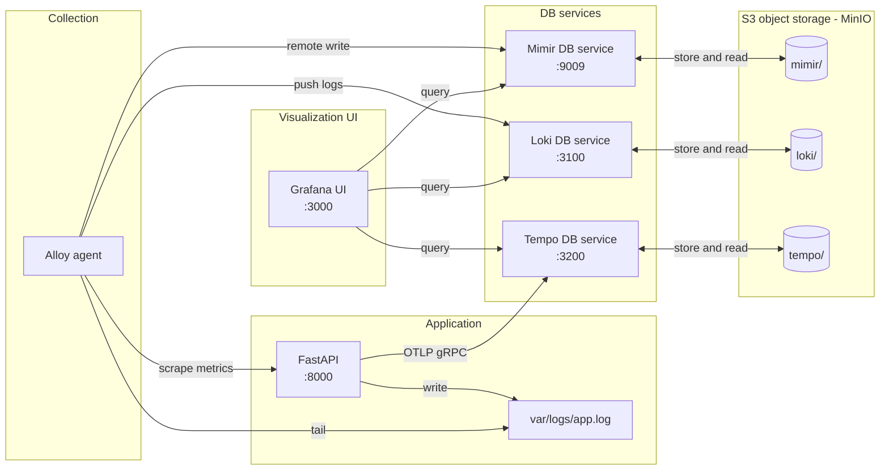
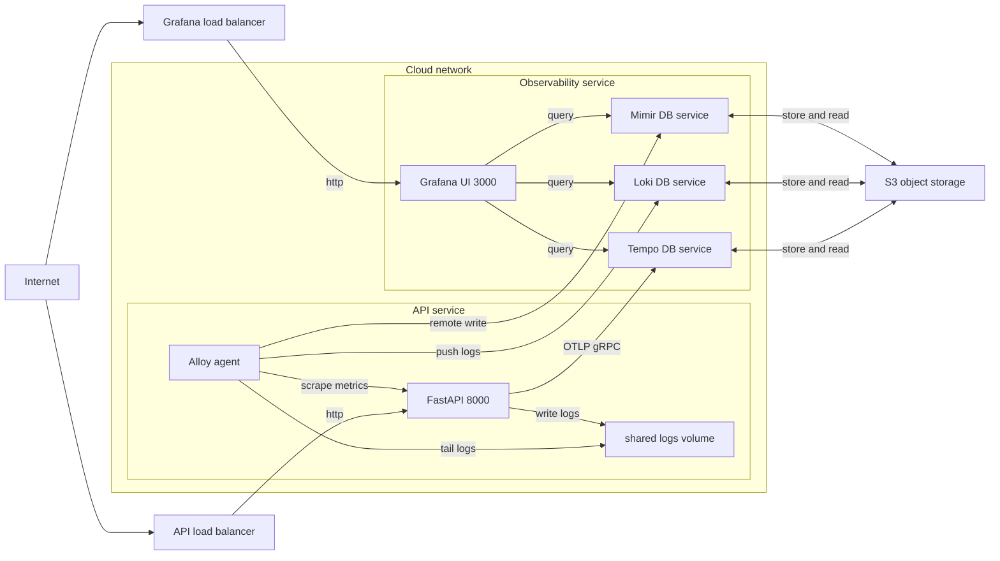

# Observability and Telemetry Demo

[](https://github.com/NicoPietrusco/observability_and_telemetry/actions/workflows/ci.yml)


[](https://github.com/astral-sh/uv)
[](https://github.com/astral-sh/ruff)

A demo project showcasing the three pillars of observability: **metrics**, **logs**, and **traces** — with S3-compatible storage.

A FastAPI service instrumented with OpenTelemetry ships its telemetry to the Grafana LGTM stack (Loki, Grafana, Tempo, Mimir), with MinIO standing in for S3. One command brings it all up, and Grafana links every log line to its trace.

**Contents:** [Architecture](#architecture) · [Cloud architecture](#cloud-architecture-prototype) · [Services](#services) · [Quick Start](#quick-start) · [Endpoints](#endpoints) · [S3 Storage](#s3-storage) · [Features](#features) · [Log Rotation](#log-rotation) · [CI](#ci)

## Architecture



## Cloud architecture (prototype)

Target: keep the **API isolated** as its own service, and run the **OSS observability backends** separately. In this repo’s implementation:
- **Alloy (sidecar)** collects **metrics + logs** from the API service and forwards them.
- **Traces** are exported **directly** from the API to Tempo (OTLP gRPC), as configured by `OTEL_EXPORTER_OTLP_ENDPOINT`.
- **S3** is the persistence layer (object storage). **Mimir/Loki/Tempo are DB services** (they run as services and read/write data to S3).



To run the prototype on a single host as two deployment units:

```bash
# Observability unit (Grafana + Mimir/Loki/Tempo + storage)
docker compose -f infra/docker-compose.obs.yml up -d

# API unit (API + Alloy sidecar agent)
docker compose -f infra/docker-compose.api.yml up -d
```

## Services

| Service | Port | Description |
|---------|------|-------------|
| API | 8000 | FastAPI application |
| MinIO | 9000/9001 | S3-compatible storage (console: 9001) |
| Mimir | 9009 | Prometheus-compatible metrics backend (remote_write + PromQL query API) |
| Loki | 3100 | Log aggregation |
| Tempo | 3200 | Distributed tracing |
| Alloy | - | Telemetry collector/agent (scrapes metrics, tails logs, forwards data) |
| Grafana | 3000 | Visualization |

### Service Descriptions

| Service | Reads From | Writes To | Goal | Description |
|---------|------------|-----------|------|-------------|
| **API** | - | `var/logs/app.log`, Tempo (OTLP gRPC) | Generate realistic app telemetry (metrics/logs/traces) with trace-aware structured logging. | FastAPI app with OpenTelemetry auto-instrumentation. Exposes Prometheus-format metrics at `/metrics` and exports traces via OTLP (`OTEL_EXPORTER_OTLP_ENDPOINT`). Logs are structured JSON and include `trace_id`/`span_id` for correlation. |
| **Alloy** | API `/metrics`, `var/logs/app.log` | Mimir (remote_write), Loki (push API) | Collect + transform telemetry at the edge and forward it to specialized backends (Prometheus-like scrape/ship). | Grafana Alloy collector (agent). In this stack it effectively replaces a standalone Prometheus: it **scrapes** `/metrics` and **remote_writes** to Mimir. It also tails local JSON logs, extracts labels/fields, and forwards them to Loki. (It is not a TSDB.) |
| **Mimir** | Alloy (Prometheus remote_write) | MinIO `mimir/` bucket | Store and query metrics at scale with Prometheus compatibility. | Prometheus-compatible metrics backend: ingests remote_write samples, serves PromQL queries to Grafana, and persists TSDB blocks/index to object storage (S3/MinIO). |
| **Loki** | Alloy (Loki push API) | MinIO `loki/` bucket | Centralize logs for search/aggregation and link them back to traces. | Log backend: ingests streams via `POST /loki/api/v1/push`, stores chunks/index in object storage, and serves LogQL queries. Labels (e.g. `service`, `level`, `method`) are derived by Alloy from the JSON logs. |
| **Tempo** | API (OTLP gRPC) | MinIO `tempo/` bucket | Store traces for end-to-end request debugging and correlation with logs/metrics. | Trace backend: receives spans via OTLP gRPC (`:4317`), stores WAL/blocks in object storage, and serves trace queries to Grafana. |
| **MinIO** | Mimir/Loki/Tempo (object-store reads) | `./var/minio/` | Provide durable object storage for backend persistence in local/dev. | S3-compatible object store used as the persistence layer for metrics/logs/traces (dev-only here). Swap to AWS S3/GCS/Azure Blob in production. |
| **Grafana** | Mimir/Loki/Tempo HTTP APIs | `./var/grafana/` | Explore, correlate, and visualize telemetry from a single UI. | UI + query engine: issues PromQL/LogQL/trace queries to the backends and links logs↔traces using the `trace_id` field (datasource provisioning sets derived fields). |

## Quick Start

**Prerequisites:** [Docker](https://docs.docker.com/get-docker/) with Compose, [just](https://github.com/casey/just), and [uv](https://github.com/astral-sh/uv) to run the API outside Docker.

```bash
# Start the stack (two units: observability + api)
just up

# Generate some traffic (or use examples/example.rest)
curl http://localhost:8000/end1/25
curl "http://localhost:8000/end2/?text=HelloWorld"

# View logs
just logs

# Stop services
just down

# Clean all data
just clean
```

## Endpoints

| Service | URL | Credentials |
|---------|-----|-------------|
| API | http://localhost:8000 | - |
| MinIO Console | http://localhost:9001 | minioadmin / minioadmin |
| Grafana | http://localhost:3000 | admin / admin |

## S3 Storage

All telemetry data is stored in MinIO (S3-compatible):

| Bucket | Contains |
|--------|----------|
| `mimir` | Metrics (time series) |
| `loki` | Logs |
| `tempo` | Traces |

Access MinIO Console at http://localhost:9001 to browse buckets.

## Features

- **Metrics** → Alloy scrapes API → Mimir → S3
- **Logs** → Alloy tails files → Loki → S3
- **Traces** → API sends OTLP → Tempo → S3
- **Log ↔ Trace correlation** in Grafana via `trace_id`

## Log Rotation

The API uses Loguru with built-in log rotation to prevent `var/logs/app.log` from growing forever:

| Setting | Value | Description |
|---------|-------|-------------|
| `rotation` | 10 MB | Rotate when file reaches 10MB |
| `retention` | 7 days | Delete logs older than 7 days |
| `compression` | gz | Compress rotated files |

Rotated logs are stored as:
```
var/logs/
├── app.log                     # Current log (tailed by Alloy)
├── app.log.2024-12-17_12-00-00.gz  # Rotated + compressed
├── app.log.2024-12-16_12-00-00.gz
└── ...
```

> **Note:** Old logs are kept locally for 7 days as backup. The canonical log storage is in Loki (S3), which has its own retention policy.

## CI

[GitHub Actions](.github/workflows/ci.yml) runs on every push to `master` and on every pull request:

| Job | What it checks |
|-----|----------------|
| **Lint** | `uv.lock` is up to date, `ruff check` and `ruff format --check` pass |
| **Docker** | Both compose files are valid, the API image builds, and a smoke test calls `/end1`, `/end2` and `/metrics` on the running container |

Format and lint locally with `just fmt`.
